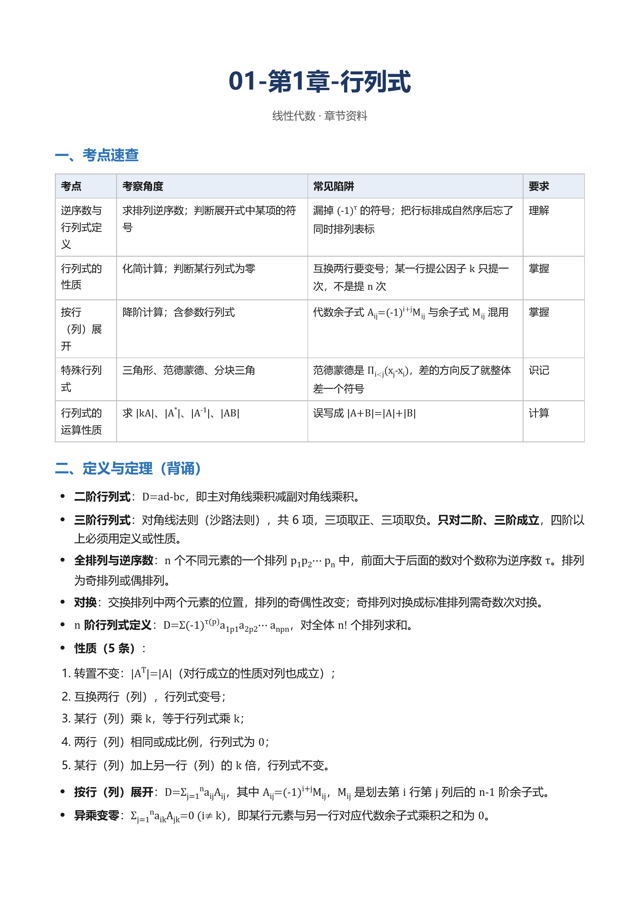

# dsh-study-kit —— DSH 资料整合与备考出题插件

[](https://github.com/SKYSNOWSTARMOON/dsh-study-kit/actions/workflows/ci.yml)
[](LICENSE)
[](package.json)

把「上传学习资料 → 解析清洗 → 切章建索引 → 统计真题考点 → 出模拟卷 → 导出 Word/PDF」做成 DSH 常驻工具，不再靠每轮对话重新解释规则。

**纯本地、零依赖、不出网**：只用 Node 内置模块，不装任何 npm 包。
docx / pptx / pdf / txt / md 的解析器都是手写的（ZIP + XML、PDF 文本层），因为这台机器没有网络也没有 `pypdf`。



---

## 它解决什么问题

用 DSH 备考，最累的从来不是「让它讲知识点」，而是每次都要重新交代：资料在哪、哪些是正文、哪些是答案、第几章、按什么格式出。换个会话就全忘。这个插件把这些**机械且必须一致**的活固化成工具：

- 一批乱文件（教材 PDF、老师发的 docx、课件 pptx、真题 Word、手机拍的习题照片）→ 清洗、判类型、去重、切章，落成一个可按章读取的资料库；
- 同一个知识点在三个文件里出现 → 只留一份，重复的标 `⇄` 跳过，不重复占上下文；
- 要交付 → 按章出 Word + PDF，放在以课程命名的文件夹里，以后补内容并进原章，不新建目录、不覆盖旧文。

**它只做确定性的事**：解析、清洗、去重、统计、排版、写文件。哪段是考点、怎么讲、出什么题，留给模型——这是刻意的分工，也是它和「一键生成整本书」类工具最大的区别。

## 谁能用、需要什么

| 项目 | 要求 |
|---|---|
| 宿主 | DeepSeek Harness（DSH），宿主插件，不需要客户端 bundle |
| Node | ≥ 18（只用内置模块，无 npm 依赖） |
| 平台 | 核心功能跨平台；**OCR 脚本、Word COM 兜底、PDF 无头打印是 Windows 专用** |
| Python（仅自测） | 造夹具用 `python-docx` / `python-pptx`，可选 |
| 系统 OCR | Windows 10/11 + zh-Hans-CN 语言包（`Windows.Media.Ocr`），完全离线 |

---

## 装

```powershell
# 1. 克隆到任意位置
git clone https://github.com/SKYSNOWSTARMOON/dsh-study-kit.git

# 2. 用 DSH 的 plugin_manager 装（传本目录绝对路径）
plugin_manager install_bundle "D:\path\to\dsh-study-kit"
```

装完 `set_plugin include:study-kit enabled=false` 再 `=true`（或新开一轮对话），工具即生效。
改了源码后同样要 false→true 才加载新代码；`install_bundle` 对已存在的 bundle 会报 `already-installed`，先 `remove_bundle` 再装。

## 三句话上手

装好之后，对着 DSH 说这三句就够了，不需要记参数：

1. **「把 `D:\资料\病理学` 里的资料入库」** → 调 `study_ingest`，返回每份的类型、字数、章节数、跳过哪些同源副本。
2. **「这门课按章做成 Word 和 PDF」** → 调 `study_course`，产出 `<工作目录>\病理学\01-第1章-xxx.docx + .pdf`。
3. **「按真题出一套模拟卷，满分 100」** → 先 `study_exam_stats` 出考点热度表，再 `study_paper` 出蓝图，模型按蓝图写题。

后面想补充内容就说「补进第 3 章」，它会并进原文件、加 `## 补充 · 日期` 段，旧正文不动。

扫描件（PDF 里选不中文字、或手机拍的书页）要先 OCR：

```powershell
# 1) 整本 OCR：每页出一份 txt，产出 <OutDir>\pages\p0001.txt + pages.json
powershell.exe -NoProfile -ExecutionPolicy Bypass -File scripts\ocr-pdf.ps1 -Pdf "D:\资料\病理学.pdf" -OutDir "D:\资料\ocr\病理学"

# 2) 按目录章名切章（章名一行一个写进 titles.txt；扫描件章号常被认错，用章名更稳）
node scripts\ocr-chapters-auto.mjs "D:\资料\ocr\病理学\pages" "D:\资料\ocr\病理学\chapters" --tocTitles titles.txt --skipBefore 12
```

再 `study_ingest` 指向 `chapters` 目录。整本 500 页实测约 18 分钟（2.1 s/页）。

---

## 工具

| 工具 | 干什么 | 典型调用 |
|---|---|---|
| `study_ingest` | 解析文件/目录入库：清页眉页脚水印页码、判类型、去重、切章 | `{path:"D:\\资料\\船舶原理"}` |
| `study_ingest_text` | 纯文本入库（OCR 结果、粘贴内容） | `{name:"第3章笔记", text:"..."}` |
| `study_outline` | 不带 doc = 资料库总览；带 doc = 章节清单（序号/字数） | `{doc:"d1"}` |
| `study_read` | 读某章原文，按序号或标题关键词 | `{doc:"d1", match:"第三章"}` |
| `study_exam_stats` | 拆题、题型分值分布、考点热度表（高频必考/常考/冷门） | `{}` |
| `study_paper` | 生成模拟卷「命题蓝图」并落盘 | `{blueprint:[{type:"计算题",count:4,score:10}], difficulty:3}` |
| `study_pack` | 把按章写好的 markdown 打包成一门课的交付文件夹（每章一个 Word，可选 PDF） | `{course:"基础生命科学", srcDir:"复习资料/pack-src", outDir:"C:\\Users\\SKY\\Desktop\\资料", format:"both"}` |
| `study_export` | 把**库里已有**的资料直接导出成 Word/PDF（一份资料一个文件，不必先摆 markdown） | `{prefix:"全本教材", format:"both"}` |
| `study_course` | **最终交付**：按章生成/增补 `<工作目录>/<课程名>/01-第1章-章名.docx + .pdf`，同一门课再补内容会并进原文件夹、并进对应章 | `{course:"基础生命科学", chapters:[{no:1,title:"生物与生命科学",markdown:"..."}], format:"both"}` |

## 课程资料包（v0.2 新增）

一次把「一门课的所有知识点 + 习题」做成可直接打印的交付物：

1. 按章写 markdown，放同一个目录：`01-第1章-xxx.md`、`02-第2章-xxx.md` …（`00-` 开头当总览页）；
   每个文件内部用 `## 一、知识点` / `## 二、习题` 分成两半，知识点与习题按章隔离。
2. `study_pack({course:"课程名", srcDir:"该目录", outDir:"想放哪", format:"docx"|"pdf"|"both"})`
3. 产出：`<outDir>/<课程名>/` 下 `00-课程总览.docx`、`01-第N章-章名.docx` …，文件名带章号所以顺序稳定。

内置了一个零依赖的 docx 生成器（`lib/docx.js` + `lib/zipwrite.js`）：标题/列表/表格/引用/代码块/粗体/分隔线都能落成真正的 OOXML，A4 版心、宋体正文、黑体标题、表格带边框与表头底色。**不装 python-docx、不调 Word 也能出文件。**

PDF 走本机 **Edge/Chrome 无头打印**（`--headless=new --print-to-pdf`），不需要 Word：先由 `lib/html.js` 把同一份 markdown 转 HTML（A4、18mm 边距、中文字体、表格底色、公式上下标），再逐份打印。实测在插件宿主进程内一次出 13 个 PDF，约 3 秒/份。

Word COM 是**兜底通道**（`scripts/word-convert.ps1`，`SaveAs2(pdf,17)`）：只在本机没有浏览器时才需要，且**必须从普通进程调用**——从 DSH 宿主进程里调 Word 会卡在 `Documents.Open`（Word 需要交互式桌面）：

```powershell
powershell.exe -NoProfile -ExecutionPolicy Bypass -File scripts\word-convert.ps1 `
  -Docx "D:\包\01-第1章.docx" -Pdf "D:\包\01-第1章.pdf" -LogPath "$env:TEMP\w.log" -Mode 2
```

`-Mode 2` 用的是 `Documents.Open(f, $false, $false, $false, "", "", $false, "", "", 0, 65001, $true, $true, $false)`；默认的 `Documents.Open(f,$false,$true)` 在部分环境会弹「修复」对话框而卡死。

## 把库里的资料导出成 Word / PDF（v0.5 新增）

`study_pack` 要求你先按章写好 markdown；如果资料**已经在库里**（入库的教材、OCR 出来的整章、生成的笔记），用 `study_export` 一步出文件：

```
study_export({prefix:"全本教材", format:"both"})        # 名字含「全本教材」的全部导出，Word + PDF
study_export({docs:["d30","d31"], format:"docx"})       # 指定 id
study_export({format:"pdf", outDir:"D:\\导出"})          # 整个库出 PDF
```

产出：`<outDir>/<folderName>/` 下一份资料一个 `.docx` 和一个同名 `.pdf`（`outDir` 默认 `<会话工作目录>\资料导出`，`folderName` 默认按 prefix）。

**OCR 文本自动重排**：OCR 出来的资料是一行一个自然段（版面换行），直接导出会碎得没法读。`study_export` 默认 `reflow:"auto"`，命中 OCR 特征（长文、几乎无题号、全是短行）时按句末标点重新组段、把短行当小标题，导出文字就是正常段落；不想重排传 `reflow:"off"`，任何文本都强制重排传 `reflow:"on"`。报告里会写「N 份 OCR 文本已按标点重排成段落」。

PDF 三条通道，按顺序试，前一条不成就换下一条，全程不需要 Office：

1. **Edge/Chrome 无头打印**（`--headless=new --print-to-pdf`）：最快，但在 DSH 沙箱里常常起不来 —— Chromium 要开命名管道，被拒时报 `mojo ... Check failed: 拒绝访问 (0x5)` 或 exit `2147483651`。
2. **DSH 自带的 LibreOffice Kit**（`@deepseek-ai/libreoffice-kit` 的 `lib/cli.js`，`convert --input x.docx --output y.pdf`）：沙箱里照样能用，**实测一份 4 万字的章节约 5 秒出 585KB PDF**，中文字体齐全（`missingFonts: []`）。插件按 `process.execPath` 反推 `app.asar.unpacked` 里的路径；装到别处时用环境变量 `STUDY_KIT_PDF_CLI` 指定 `cli.js` 绝对路径。
3. **Word COM**（`convertToPdf`）：最后退路。本机 Word 在 DSH 沙箱里 `Documents.Open` 会报「Word 在试图打开文件时遇到错误」或直接卡住，所以别指望它。

实际报告里会写明走了哪条通道（`ℹ 无头浏览器出不了 PDF…已改用 DSH 自带 LibreOffice Kit 转换`），PDF 会校验 `%PDF-` 头，没产出就如实报错，不假装成功。

## 课程文件夹：按章交付 + 增补合并（v0.6 新增）

`study_pack` 是「一次生成一整套」，`study_course` 是「**同一门课反复补**」——用户要的最终形态就是它：

```
study_course({
  course: "基础生命科学",
  format: "both",
  chapters: [
    { no: 1, title: "生物与生命科学", markdown: "## 一、知识点\n\n..." },
    { no: 2, title: "生物的化学组成", markdown: "..." }
  ]
})
```

产出 `C:\Users\SKY\Desktop\资料\基础生命科学\01-第1章-生物与生命科学.docx` + `.pdf`（`outDir` 默认=会话工作目录）。

再补内容时传同一个 `course`，规则是**不覆盖、只增补**：

- 新内容已经被旧章节覆盖（重合 ≥0.7）→ 跳过，不重复写一遍；
- 新内容覆盖了旧章节大半（≥0.9）→ 整章替换（旧的是残缺版）；
- 其余 → 追加到 `## 补充 · 日期` 下，旧内容一字不动；
- 已存在的旧包（手工做的、`study_pack` 出过但没留源 markdown 的）第一次被增补时，会从 `.docx` 里把正文抠回来当基线（adopt），所以「补充到原有课的文件夹」对老文件夹同样成立。

源 markdown 镜像存在 `<课程文件夹>\.course-md\<章>.md`，索引在 `.course-md\_index.md`（章号/标题/字数/本次操作/更新时间）。`merge:false` 可强制整章覆盖。

**只登记**（把一个已有课程包纳入管理）：章只给 `title`、`markdown` 留空，工具会从同名 `.docx` 抠正文写进 `.course-md\`、重写索引，**不动 Word/PDF**。旧包的文件名可以直接当 `title` 传（`{title:"01-第1章-生物与生命科学"}`），章号与标题会从文件名解析：

```js
study_course({ course: "基础生命科学", chapters: [{ title: "01-第1章-生物与生命科学" }] })
```

登记过的课程，之后所有增补都走同一套合并规则；没登记的也能增补（靠 adopt），只是每次都要重新抠一遍 docx。

## Anki 卡片（v0.8 新增）

想让背的东西进 Anki，就加 `anki:true`：

```js
study_course({ course: "线性代数", format: "docx", anki: true, chapters: [{ no: 1, title: "行列式" }] })
```

产物 `<课程文件夹>\anki\01-第1章-行列式.txt`，Anki → 文件 → 导入 → 选「制表符分隔」，卡组自动分成 `线性代数::第1章`。

卡片的来源只有一个：章节里的 **`## 背诵清单`** 小节。认三种写法：

```md
| 正面 | 背面 | 标签 |
| --- | --- | --- |
| 逆序数的定义？ | 排列中前面大于后面的数对个数 | 行列式 |

- **三阶行列式能用对角线法则吗**：能，四阶以上不能
- 行列式互换两行会怎样？｜变号｜性质
```

**不自动编卡**：没写背诵清单就一张卡也不出，报告里直说「没有找到「背诵清单」小节」。自动从正文抽句子做出来的卡，正面永远是「这句话是什么意思」，背面是一整段——那种卡背不下去，不如不做。

数学公式会转成 `\(...\)`，Anki 偏好设置里勾上 MathJax 才渲染；没勾就显示原文，不会丢内容。

## 走一遍

从装到出成品到 Anki 卡片的完整命令与真实输出：[examples/walkthrough.md](examples/walkthrough.md)。

## 工作流

```
study_ingest  →  study_outline  →  study_read  →  study_exam_stats  →  study_paper  →  按骨架填题
```

`study_paper` 只出**骨架**（每题钉死考点、难度、分值、命题要求、避重原题号、评分要点位），题干与答案由模型填 —— 这样分值合计和题型配比不会跑偏，填完还能用 `validatePaper` 校验。

---

## 落盘位置

```
<会话工作目录>/.study-kit/
  index.json          文档索引（章节偏移、真题题数）
  docs/d1.md          清洗后的全文
  papers/模拟卷.md     生成的命题蓝图
```

正文与索引分开存：`study_read` 只按字符偏移切一章，读一本 200 页的教材不会把整本塞进上下文。

---

## 扫描版 PDF / 图片：先 OCR 再入库

插件本体不含 OCR 引擎，但带了一个只用系统自带能力的脚本（Windows.Data.Pdf 渲染 + Windows.Media.Ocr 识别，**完全离线、不用装任何东西**，需要系统里有 zh-Hans-CN 语言包）。

```powershell
# 必须用 Windows PowerShell 5.1，不要用 pwsh 7（7 加载不了 System.Runtime.WindowsRuntime）
# 不给 -From/-To 就是整本
powershell.exe -NoProfile -ExecutionPolicy Bypass -File scripts\ocr-pdf.ps1 `
  -Pdf "D:\教材.pdf" -OutDir "D:\ocr\教材" -Width 1700
```

产出 `<OutDir>\pages\p0001.txt`（每页已按版面 XY-cut 重排阅读顺序、去中文间空格）与 `pages.json`（每页字数，用来发现空白页/纯图页）。`-Chapters chapters.json` 可按写死的页区间拆章。

实测（501 页扫描教材、1700px 宽）：**约 2.1 s/页，整本 18 分钟**，单页 1300 字上下。正文可读，但目录页、图表页、公式会出乱码（OCR 固有噪声，`study_read` 里能看出来）。

### 切章：按目录章名定位，别信 OCR 认出来的章号

```powershell
# 章名一行一章，顺序与书一致
@("生物与生命科学","生物的化学组成","细胞——生命的基本单位","能量与代谢","遗传及其分子基础","发育","进化","植物的结构与功能","动物的结构与功能","生物与环境","人体健康与重大疾病预防","生物技术与人类未来") |
  Set-Content D:\ocr\教材\titles.txt -Encoding UTF8

node scripts\ocr-chapters-auto.mjs D:\ocr\教材\pages D:\ocr\教材\chapters `
  --tocTitles D:\ocr\教材\titles.txt --skipBefore 14
```

- `--tocTitles`：按页首出现的章名定位章起点。扫描件把「第 1 章」认成「第 7 章」、「第七章」认成「第丿章」是常态，只靠章号会漏章——实测同一本书，章号模式切出 11 章（把三章并成一个 90 页大块），章名模式 **12/12 全中**、页区间也对。
- `--skipBefore N`：跳过封面/序言/目录的页数（目录页每章名都出现，不跳过会把目录当成章起点）。
- `--reflow`：把 OCR 的视觉行合并成段落。默认不合并（一行一视觉行，更像原书版面）；合并后「正文长段占比」从 2% 涨到 79%、分类置信 0.25→0.8，代价是长句糊成大段、小标题会被并进正文。
- 不给 `--tocTitles` 时退回「第N章」检测（`--keepNumbers` 保留 OCR 认到的章号，默认按出现顺序重编号）。

再 `study_ingest({path:"D:\\ocr\\教材\\chapters"})`。实测 12 章：每章 3.0~8.0 万字、29~65 节，**全部判为教材正文**（置信 0.62；OCR 逐行文本没有长段，分类器对此有专门规则）。

### 零散图片（截图 / 拍照页 / 课件截图）

```powershell
powershell.exe -NoProfile -ExecutionPolicy Bypass -File scripts\ocr-image.ps1 `
  -Image "D:\a.png","D:\b.jpg" -OutDir "D:\ocr\imgs"
```

同一套 Windows.Media.Ocr 引擎，`-Language` 默认 `zh-Hans-CN`；产出 `<OutDir>\<图名>.txt`（按行框的 y 分桶再按 x 排序，还原阅读顺序；中文之间的空格已去掉）。实测一张渲染页 1800×2547、约 2 秒。识别质量与 PDF 版一致（正文可读，图表与公式有噪声），识别完的 txt 直接 `study_ingest` 入库。

---

## 已知缺点与限制（先说清楚，省得踩坑）

这份清单是刻意写全的：一个自研解析器 + 启发式分类器的工具，最怕使用者以为它什么都能吃。

**能力上的硬限制**

| 限制 | 后果 | 现状 |
|---|---|---|
| 扫描件的公式、矩阵、上下标 | OCR 出来基本是废的（`\sum` 的下标丢失、分式变两行、根号认成字母） | 不假装能读；OCR 只保证正文散文可检索，公式请回原书 |
| PDF 里的图表、图片 | 不提取，也不做图注 | 图文混排的教材会丢图，只剩图注文字 |
| 复杂表格 | 按文本行重排，跨页表、合并单元格会散成文字 | 简单表格（N 行 M 列）正常 |
| 加密 / 特殊 CID 字体的 PDF | 抽不出文字 | 报「没抽到文字」，给 OCR 指引 |
| 手写体、拍照倾斜、光照差的图片 | 识别率骤降 | 无预处理（不纠偏、不去阴影） |
| 教材改版 | 不同版本措辞差异大，重合度低于阈值就**不会**被当同源 | 会被当成两份资料入库（宁可重复，不可误删） |

**功能上的缺口（还没做）**

- **冲突来源标注**：多份资料对同一概念说法不一致时，不会自动标「来源 A 说 X、来源 B 说 Y」，需要模型自己发现。
- **Anki 导出**：没有。卡片质量取决于内容改写，不是导出格式，所以没硬塞进工具。
- **考点索引没持久化**：章节索引有，但「考点 / 难度 / 真题频次」每次现算，没落成可查询的库；`study_exam_stats` 因此偏弱。
- **同义术语不合并**：「稳性 / 稳定性」「最大无关组 / 极大无关组」会算成两个考点，要靠人工归并。
- **`study_paper` 只出蓝图**：题干、答案、评分要点由模型填。它保证配比、分值、难度、避重，不保证题目文笔。
- **没有全文搜索**：只能按文档 + 章节读，不能跨库 grep 关键词。
- **分类器阈值是经验值**：在生物、线代两门课上标定过；法律条文、代码、语言类资料需要重新标定。
- **解析结果入库时写死**：改了清洗/判定逻辑，旧库不会自动重算，得删 `.study-kit` 重新 ingest。

**工程上的取舍**

- 解析器是手写的，**只覆盖见过的情况**。遇到新排版会漏，不会报错——所以入库报告里的字数、章节数、置信度要瞄一眼。
- 零依赖换来「随处能跑」，代价是 PDF 解析能力远不如 `pypdf`／`pdfplumber`，拿它们当对照基准会失望。
- PDF 输出依赖本机浏览器或 DSH 自带 LibreOffice Kit；两者都没有的环境只能出 Word。

---

## 能力边界（实现细节）

| 情况 | 行为 |
|---|---|
| PDF 有文本层 | 正常抽取（Flate/ObjStm/ToUnicode CMap/Tj-TJ 都支持）；每行一个 `BT` 的打印件也能按 y 断行 |
| 同一份资料的 docx + pdf | 入库时按内容比重合，重合 ≥0.85（或同名不同格式 ≥0.5）的那份直接跳过，报告标 `⇄` |
| PDF 是扫描件（无文本层） | 明确告警「很可能是扫描件，需要 OCR」并给出 `scripts/ocr-pdf.ps1` 的做法，**不瞎猜内容** |
| 图片 | 本插件不含 OCR 引擎。返回提示：先用 `modlens_read_image` 读成文字，再 `study_ingest_text` 入库 |
| 中文 PDF | ToUnicode 路径已实现，但**没有真实中文 PDF 样本验证过**（本机唯一 PDF 是空白表单） |
| 老 GBK 编码 txt | 自动回退 GBK 解码 |
| 排版不规整的试卷 | 拆题会漏；题号数与拆出数偏差 >3 时报「可能漏题」 |
| 考点统计 | 中文 n-gram 词频聚类，**同义词不会自动合并**（「稳性」/「稳定性」），输出里会写明，请人工归并 |
| 考点提质 | 已过滤断词残片（「大倾」「性高」）与泛词（「船舶」「高度」「公式」）；判据是「左右各加一字后覆盖率仍 ≥85% 则视为残片」 |

---

## 几个设计取舍（踩过坑才这么写的）

- **考点热度按档位加权，不按出现次数加权**：真题里出现 6 次的考点若按次数复制，会占掉全卷一半题位；现在是 `高频必考 3 / 常考 2 / 冷门 1` 份进池 + **不放回抽样**，抽空重洗，且不与上一题连考同一考点。12 题样卷实测分布 6/3/3，同种子可复现。
- **泛词黑名单只做精确匹配**：`STOPWORDS` 若按前缀剔除，「船舶稳性」「初稳性高度」会被「船舶」「初稳」连坐删掉。领域前缀必须保留。
- **类型判定用「顺序级联」，不用加权求和**：加权求和会让「文件里出现过『答案』二字」压过「答案只占 9% 篇幅」，实测把 24 份知识点+习题混排的复习资料全判成了参考答案。现在是按证据强弱依次判定（试卷 → 参考答案 → 习题 → 课件 → 笔记 → 教材正文），每一级都用**篇幅占比**开门：`ansShare>=0.4` 才算参考答案，`numShare>=0.25 && ansShare<0.2` 才算习题，`proseShare>=0.35` 就是正文为主。同一批资料现在 13/13 判为教材正文，混排时信号写「正文为主、附习题与答案（答案占 8%）」，用户一眼能看出它其实带习题。
- **去重的 shingle 步长必须是 1**：`shingles()` 原来按 `step=4` 抽样，两份逐字相同的文档只要空格位置差一点，采样点就整体错开，重合度从 0.90 掉到 0.27，去重直接失效。抽样省下的那点 CPU 换不来任何东西。
- **同源重复在入库前就跳过**：同一份资料的 docx 与它的 pdf 打印件重合度实测 0.89~0.94，现在入库前先比内容（双向 containment，阈值 0.85；同名不同格式放宽到 0.5，因为短文档会被页码稀释到 0.7），重复的那份直接不入库，报告里标 `⇄ 与 d3 同源（重合 0.91），跳过入库`。26 份目录实测入库 13 份、跳过 13 份。字节完全相同的那份走哈希复用，仍显示「已存在，复用」。
- **PDF 断行不能靠 `BT` 重置基线**：Edge/Chrome 打印出的 PDF 每行一个 `BT`，原来 `BT` 里把 `lastY` 清空，换行判定永远拿不到上一行的 y，8 页文档只抽出 14 个换行、整页拼成一行（切章只剩 2 段，分类还被虚高的题号占比带成「习题」）。改成 `BT` 只重置 x 之后：换行 14→252，切章 2→22 节。
- **解析结果在入库时写死**（类型、章节偏移、题数）。改了清洗/判定逻辑后，旧资料库不会自动重算 —— 删 `.study-kit` 重新 ingest。

---

## 输出契约（插件自动注入 systemPrompt）

- 只给干货，不写客套与铺垫；
- 资料外内容标【拓展】，不确定标【存疑】，原文自相矛盾标【原文疑似错误】，不编造文献与数据；
- 每个考点按「考察角度 / 常见陷阱 / 背诵要点」组织；专业课区分 了解 / 识记 / 掌握 / 计算；
- 公式用 Markdown LaTeX；对比类内容用表格；
- 五种输出形态：精简背诵版 / 详细完整版 / 对比归纳版 / 思维导图文本版 / 错题本。

---

## 自测

```powershell
$node = "C:\Users\SKY\.dsh\dsh-runtimes\dsh-primary-runtime\dependencies\node\bin\node.exe"
# 先造夹具（只造一次；python 路径按本机改）
& $python scripts/make-fixtures.py      .tmp/study-fixtures
& $python scripts/make-pdf-fixture.py   .tmp/study-fixtures
# 跑自测：不传参数时用 <插件>/../.tmp/study-fixtures，也可以显式传目录或用 STUDY_FIXTURES 环境变量
& $node scripts/selftest.mjs .tmp/study-fixtures
```

自测会：入库（docx 教材 + docx 真题 + pptx 课件 + 手搓 PDF）→ 同源去重 → 索引 → 读章节 → 真题统计 → 命题蓝图 → 课程文件夹增补/只登记/重渲染 → 表格与公式渲染，逐项断言。
当前 **58 项全部通过**（覆盖表格保序、页眉水印清除、PDF 两页抽取与断行、12 题拆分、100 分合计、热度表无泛词残片、同源副本被跳过、重复入库走复用、同种子可复现、`$|A|$` 不被竖线切断、嵌套下标不残留 LaTeX、粗体里的公式渲染成上下标、表格固定列宽、rerender 重写 Word 但不改正文、Anki 卡片生成与字段清理）。

真机（装进 DSH 后）已跑通：4 份样本入库 → 类型与置信度正确（试卷 0.9 / 课件 0.8 / 教材正文 0.5 / PDF 0.65）→ 3 条干净考点 → 蓝图满分 100、12 题、题型配比 5×2 / 2×5 / 3×10 / 2×25、校验无 issue。
真实资料实测：

- `基础生命科学`（12 章 docx + 12 章 pdf + 2 份总览，共 26 份）→ 入库 13 份、跳过 13 份同位 pdf，13/13 判为教材正文，章内切出 7~32 节。
- 同书两本扫描 PDF（501 页 + 337 页）→ 整本 OCR 18.0 / 10.9 分钟，按目录章名切章 12/12，入库 24 份全部判为教材正文（0.51~0.62）。
- `线性代数`（同济第七版，184 页扫描件）→ OCR 3.6 分钟、6/6 章切分正确，产出 7 份 Word + 7 份 PDF（`00-课程总览` + 6 章，docx 6.0~6.9KB、pdf 224~271KB）。

---

## 开发

```
lib/            15 个模块，全部零依赖
  index.js      插件入口：注册 9 个工具 + 注入 systemPrompt 输出契约
  tools.js      工具定义与业务流程（47KB，主体）
  clean.js      清洗、类型判定（顺序级联）、shingle 去重
  office.js     docx/pptx 读取
  pdf.js        PDF 文本层抽取（Flate / ObjStm / ToUnicode / Tj-TJ）
  docx.js       OOXML 生成（标题/列表/表格/公式/页眉页脚）
  html.js       markdown → HTML（PDF 打印用）
  tex.js        LaTeX 子集 → 上下标与符号
  export.js     study_pack / study_export / study_course 的落盘与合并
  anki.js       背诵清单 → Anki TSV 卡片（parseCards / cardsToAnki）
  stats.js      真题拆题与考点热度
  paper.js      命题蓝图与校验
  store.js      资料库索引与读写
  zip.js / zipwrite.js   ZIP 读 / 写
scripts/        OCR、切章、夹具生成、自测
  ocr-pdf.ps1           整本扫描 PDF → 每页文本（Windows.Media.Ocr）
  ocr-image.ps1         零散图片 → 文本
  ocr-chapters-auto.mjs 按目录章名切章（--tocTitles）
  selftest.mjs          58 项端到端自测
```

约束（提 PR 前请先看）：

1. **不加运行时依赖**。需要的能力用 Node 内置模块或调用系统已有程序实现，这是这个项目的核心取舍。
2. **改判定逻辑必须同步改自测**，并说明阈值依据（哪个数据支撑这个数字）。历史 bug 的成因写在代码注释里，别删。
3. **不确定就报错，不要猜**：解析失败输出「哪几段不可用」，不编造内容。
4. 中文 JSON / YAML / 模板字符串**用编辑器改**，别用 PowerShell 管道重写（会把 UTF-8 当 GBK 再编码，中文变乱码；模板字符串里的 `${}` 会被 PS 吸掉）。

---

## 贡献

欢迎 issue 与 PR。适合上手的方向：

- 增补解析器覆盖（新排版、新 PDF 字体编码、xlsx 支持）；
- 把 OCR 结果做**领域词纠正**（教材术语表 + 编辑距离）；
- 考点索引持久化（`index.json` 增 `points[]`：考点 → 章 → 难度 → 真题频次）；
- Anki 导出（带 `#separator:tab / #deck:` 头的两列 TSV，纯文本零依赖）；
- 多来源冲突检测（同考点不同表述 → 标注来源差异）。

提交前请跑通 `node scripts/selftest.mjs <夹具目录>`，并在 PR 描述里写清楚「改了什么、为什么、怎么验证的」。

---

## 许可

MIT，见 [LICENSE](LICENSE)。代码可自由使用、修改、再分发，保留版权声明即可。
